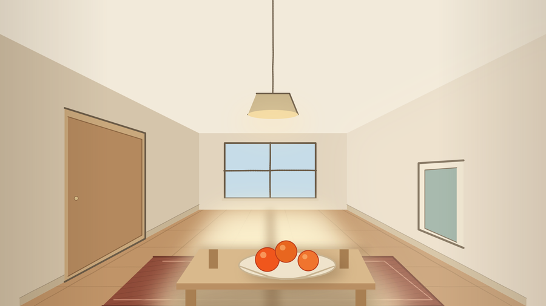

# 小飞鱼画板 · dsh-feiyu-board

> **v1.9.0** · 2026-11-25 · [变更记录](CHANGELOG.md)
> 判版本：`fyb --version`。文档和行为对不上时，先比版本号。

一个**用文本描述画面**、由 Python 渲染成 PNG 的小画板。

写一行行命令（`curve` / `poly` / `ink` / `grad` …），得到一个 `.fyb` 场景文件，
再渲染成图片。笔触是"手抖"的——每一笔都带随机抖动、起笔收笔的出锋、
粗细变化，所以画出来不像矢量图，像**手绘**。同一个 seed 永远出同一张。

> 这是给自己用的工具，不是产品。目标是"我能自己动手画"，
> 所以它偏重**可编程**（变量、宏、循环、图层）而不是点点点的界面。



---

## 一、30 秒跑起来

需要 **Python 3.10+**（开发时用的是 3.12）。

Windows 上最省事：双击 **`安装.cmd`**。它会建虚拟环境、装依赖，最后试渲染一张确认能跑。

装完之后用 **`fyb.cmd`**，**在任何目录**都能调（用绝对路径指过去就行）：

```bat
fyb.cmd check  scenes\apple.fyb          :: 只检查语法，不画
fyb.cmd render scenes\apple.fyb --out renders\apple.png
```

> 它内部用的是 `fyb.py` 启动器——`python -m fyb` 只有在包目录里才能跑
> （Python 从当前目录找模块），`fyb.py` 会把自己的目录塞进 `sys.path`，
> 所以换到哪个目录都行。嫌麻烦就把整个目录加到 PATH。

手动装：

```bash
python -m venv .venv
.venv\Scripts\pip install -r requirements.txt      # Windows
# source .venv/bin/activate && pip install -r requirements.txt   # macOS / Linux
```

之后在包目录里可以直接 `python fyb.py render scenes/apple.fyb --out a.png`，
或者装成命令（需要能连 PyPI）：`pip install -e .`，之后任何目录都能敲 `fyb`。

依赖只有三个：**PySide6**（画图）、**numpy**（模糊/纹理/追踪）、**Pillow**（读参考图）。

---

## 二、目录里有什么

```
fyb/            引擎本体（编译 → IR → 渲染）
  lexer.py        切词、处理续行和注释
  expand.py       include / let / def（宏）
  parser.py       每条命令的语法与取值
  resolve.py      展开成图元（分组、along、use、blend、blur）
  ir.py           中间表示 Prim
  pen.py          笔：重采样、抖动、出锋、逐点笔宽、胶囊描边
  painter.py      上色（裁剪、混合、模糊层、阴影、排线）
  texture.py      程序化纸纹/颗粒/飞白
  blur.py         快速模糊
  trace.py        参考图 → 点列（骨架 / 轮廓）
  cli.py          命令行
scenes/         23 个示例场景，都能直接跑
tests/          16 个测试脚本
tools/          辅助脚本（参考图网格、手部生成器、JS 对照）
samples/        几张渲染结果
plugin/         **DSH 插件**：侧栏面板 + 画廊 + 实时预览（见下一节）
DSL.md          **语法手册（要看就看这个）**
M0~M4-结论.md    各阶段做完了什么、踩了什么坑
```

---

## 三、装到 DSH 里当面板（可选）

命令行能画，但装进 DSH 之后会多一个**侧栏面板**：

- 左边栏出现「小飞鱼画板」图标；
- 点开是实时预览卡片（改了 `.fyb` 自动重画）；
- 下面是画廊，点任意一张看大图；
- 也给会话里的 AI 提供 `fyb_draw` / `fyb_scenes` / `fyb_doc` 三个工具。

装法（需要一个已经能用的 DSH）：

1. 先按第一节把 **`.venv` 建好**——插件默认调 `<包目录>/.venv/Scripts/python.exe`；
2. 在 DSH 里安装插件，指向 **`<包目录>/plugin`** 这个目录
   （`plugin_manager install_bundle`，target 填它的绝对路径）；
3. 重启 DSH，或按提示重新加载；
4. 左侧栏应该出现画板入口。

要点：

- 插件用 `resolve(__dirname, '..')` 找引擎，**所以 `plugin/` 必须留在包目录里**，
  别单独拷出去。
- 它只支持 **Windows**（写死了 `.venv\Scripts\python.exe`）。
  想在别的系统用，改 `plugin/index.js` 第 21 行那个 `PYTHON` 常量即可。
- 不装插件完全不影响命令行——两者是独立的。

---

## 四、常用命令

| 命令 | 干什么 |
|---|---|
| `check` | 只编译，报语法错（带行号和波浪线） |
| `render` | 渲染成 PNG，`--scale 2` 是两倍超采样后再缩小 |
| `watch` | 盯着目录，改哪个文件就重画 `renders/_preview.png` |
| `anim` | 生成逐笔动画（APNG） |
| `meta` | 打印画布/图元统计 |
| `sweep` | 同场景换 seed 批量出图，挑一张 |
| `trace` | **参考图 → 点列**（线稿用 skeleton，照片用 contour） |

几个常用参数：

```bash
--scale 2            # 超采样倍率，2 最合适
--seed 42            # 全局随机种子
--under ref.png      # 垫一张参考图在下面（对位用）
--under-alpha 0.4    # 参考图透明度
--fast               # 关抗锯齿/关模糊，预览用
--dump-ir            # 打印编译后的图元，查错用
```

---

## 五、语法长什么样

```fyb
canvas 1920x1080
bg #F6EFE2

let 铅 = #3B342B                      # 变量

hand preset=pencil seed=7             # 换"手"：铅笔

# 一条抖动的线：起笔收锋、带纸纹
curve [100,200 300,180 500,260] w=8 stroke=$铅 tex=paper taper=0.5

# 多边形 + 径向渐变
poly [600,300 900,300 900,600] fill=#C0472B
grad circle 750,450,160 from=#FFFFFF to=#FFFFFF00

# 裁剪：先画一个"看不见的形状"当靶子
rect 100,700,400,200 fill=none stroke=none name=body
clip body
  hatch ref=body angle=45 spacing=9 w=2 color=#8A6440
endclip

# 宏（可带参数）
def 眼睛 (x)
  circle $x,400,18 fill=#22303A
  circle $x,394,5  fill=#FFFFFF
enddef
眼睛 800
眼睛 1100
```

完整清单见 **DSL.md**：五种笔、七种形状、混合模式、模糊、纹理、
`along`（沿路径复制）、`use`（复用组）、`box`（按包围盒摆放）。

---

## 六、例子

```bash
python -m fyb render scenes/room.fyb       --out renders/room.png --scale 2
python -m fyb render scenes/orange2.fyb    --out renders/orange.png
python -m fyb render scenes/hand-drawn.fyb --out renders/hand.png
python -m fyb anim   scenes/apple.fyb      --out renders/apple.apng
python -m fyb trace  refs/hands.jpg --mode skeleton --out scenes/hand.fyb
```

`scenes/` 里按难度排：

| 场景 | 看点 |
|---|---|
| `sketch.fyb` | 最简：几笔线 |
| `orange2.fyb` | 渐变 + multiply 做体积 |
| `apple.fyb` | 阴影、高光 |
| `cat-sticker.fyb` | 表情包风格、多层 |
| `rain-window.fyb` | 模糊、纹理、光 |
| `whale-girl.fyb` | 多图层场景 |
| `room.fyb` | **一点透视**，坐标是按灭点算的 |
| `hand-drawn.fyb` | 参考图追踪后重画 |

---

## 七、测试

```bash
python tests/run_good.py     # 6 个正常场景
python tests/run_bad.py      # 17 个错误用例，断言错误码和行号
python tests/run_macro.py    # include / let / def
python tests/run_clip.py     # 裁剪（含嵌套求交）
python tests/run_blend.py    # 混合模式
python tests/run_blur.py     # 模糊
python tests/run_tex.py      # 纹理（含跨进程一致性）
python tests/run_trace.py    # 参考图追踪
python tests/run_along.py    # along（含嵌套、use 复制）
python tests/run_grad.py     # 形状内渐变 grad ref
python tests/run_group.py    # 组透明
python tests/run_use.py      # use 复用的引用重映射
python tests/run_posterize.py  # 图片按颜色分层矢量化
python tests/run_texdir.py     # 纹理跟着笔走
python tests/run_balance.py    # 构图体检（覆盖率网格）
python tests/pen_parity.py   # 和 JS 版笔的数值对照（没有 node 会跳过）
```

全部应该输出"全部通过"。

---

## 八、已知限制

老实说清楚的：

1. **画不了复杂有机形**。手我画了七版才勉强，靠的是"追踪参考图 → 取舍 → 重画"。
   参数化去逼近手、脸、动物，基本会失败。人物、多形状插画这类，
   走 `fyb posterize`（按颜色分层矢量化）比自己画靠谱——但它产出的是纯色块，
   没有笔触和细节。
2. **没有撤销/图层管理**。场景是纯文本，靠编辑器。
3. **文字只有单行**，且要用系统字体。
4. **模糊层按图元包围盒开**，大面积模糊（比如整墙的光）会慢：1080p 三个大模糊块约 2 秒。
5. **没有 SVG 导出**，只有 PNG。
6. **没有位图贴图**（`image` 命令还没做）。
7. 拖动鼠标画画？没有 GUI。这是刻意的——先要"能编程的画"。

---

## 九、迁移到别的机器

这个包里**没有任何绝对路径**，整目录拷走就能用。步骤：

1. 装 Python 3.10+；
2. `python -m venv .venv` 然后 `pip install -r requirements.txt`；
3. `python -m fyb render scenes/apple.fyb --out out.png`。

要注意的：

- **中文字体**：`text` 用的是系统字体（微软雅黑等）。Linux 上没装中文字体时
  文字会变方块，装一份 Noto Sans CJK 就好。
- **没有 GPU 依赖**：Qt 是离屏渲染，只要能开 `QImage` 就行。服务器上没有显示器
  也能跑（Qt 用 offscreen 平台）。
- **可复现**：同一 `.fyb` + 同一 seed，在哪台机器上都出同一张图。
  纹理用的是自写的 FNV-1a 而不是 Python 内置 `hash()`（后者每进程都变）。

---

## 十、来龙去脉

这套东西是照着"肥鱼画板"的思路重写的：那边是 JSON 几何 + 卡通化管线，
这边是**文本 DSL + 自己的笔**。分四个阶段做的，每个阶段都有结论文档：

- **M0** 笔：把 dsh-scribble 的笔逐位移植过来（`pen_parity.py` 证明逐位一致）
- **M1** 编译器：切词、报错（带行号和波浪线）、五种笔七种形状
- **M2** 场景：分组、`along`、`use`、`box`、混合模式
- **M3** 手：逐点笔宽、纸纹、飞白、模糊
- **M4** 外壳：DSH 插件（侧栏面板 + 画廊 + 实时预览）

想改笔的手感，看 `fyb/pen.py` 顶部的注释；
想加语法，看 `parser.py` 的 `VERBS` 和 `DSL.md` 的对应小节。

---

## 许可

MIT License —— 见 [LICENSE](LICENSE)。随便用、改、商用，留个版权声明就行。

```
Copyright (c) 2026 XiaoFeiYu-66
```

## 装进 DSH 当插件

`plugin/` 是这个仓库的 DSH 插件，带一个网页面板（画库 + 实时预览）。
装法见 [plugin/README.md](plugin/README.md)。

插件会自动找 Python，顺序是：环境变量 `FYB_PYTHON` → 画板目录下的 `.venv`
→ PATH 上的 `python`／`python3`。都不行时会明确告诉你去装哪一个。
