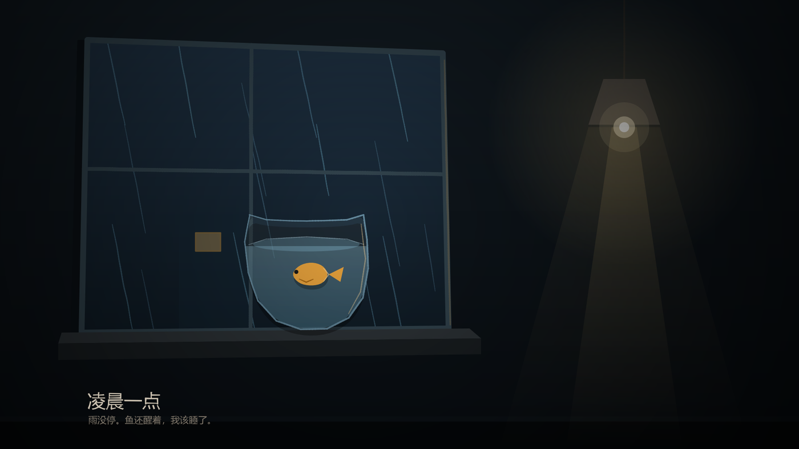
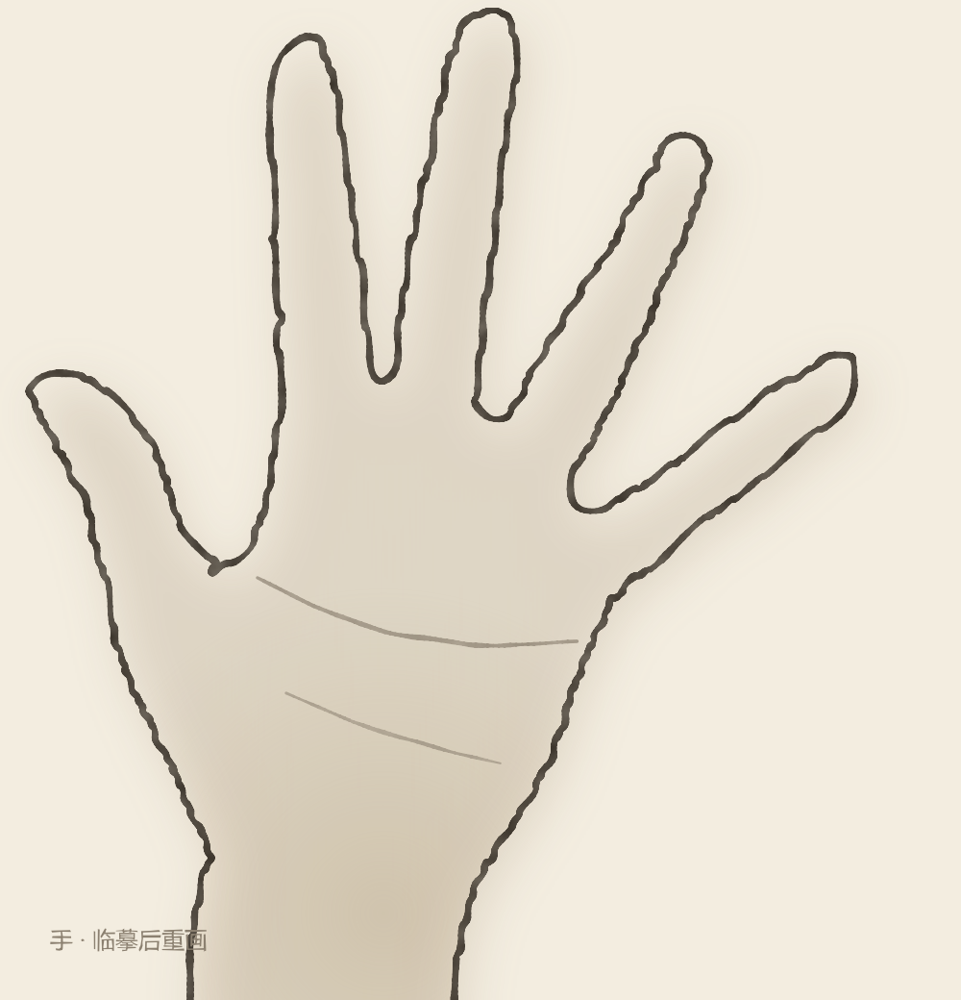
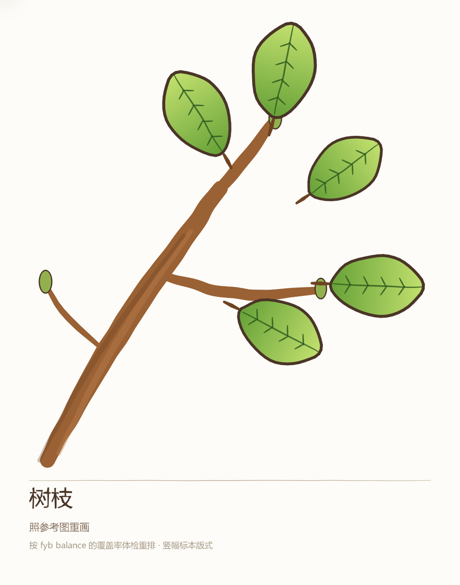
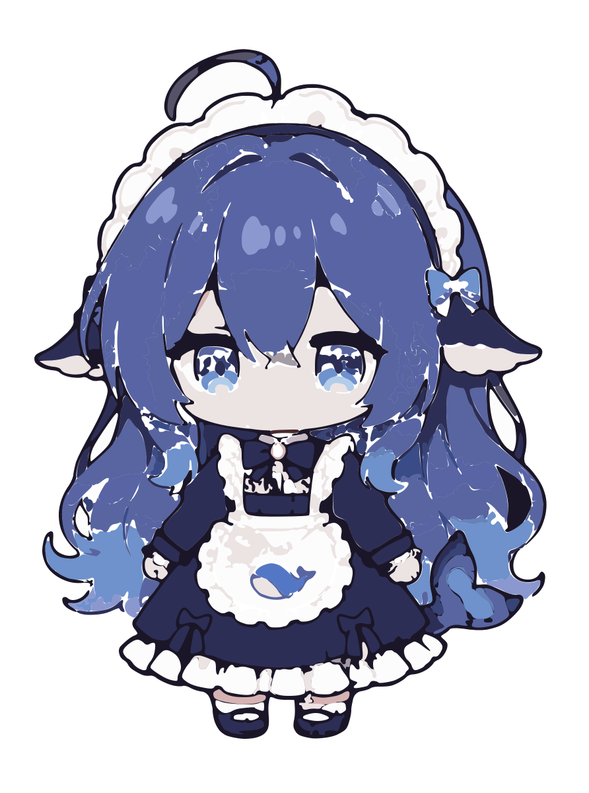

# 小飞鱼画板

## 一句话

**一种用文本描述画面、由程序照着画出来的画板。** 写好 `.fyb` 文件里的一段描述，敲一行命令，就得到一张 PNG。

它不给你鼠标和画笔，给你的是一支**会抖的笔**和一套**能算的几何**——画什么由文字决定，怎么"手绘"由算法决定。

---

## 为什么做这个

起初的动机很具体：想让 AI 真的"会画画"，而不是靠扩散模型碰运气。

看一个更早的方案时发现，那套东西的画板把渲染做成了黑盒——效果图里鱼的眼睛、墨线、浪花全丢了，验收标准却还给了满分。**毛病出在验收标准管不到的地方，也就没人发现。**

所以这个画板的原则是反过来的：

1. **每一笔都要能说清是怎么来的**——不是"模型觉得该这样"，是"这里抖了 0.3、那里收细了 40%"。
2. **错了要报错**，而且报在**行号和列号**上，不是"加载失败"。
3. **同一份文件，每次画出来必须一模一样**——随机数按笔名散列，跨进程也一致。

---

## 能画什么

二十四张示例场景都在包里，随便跑。挑几张：

| 图 | 说明 |
|---|---|
| 雨窗 | 玻璃、雨丝、窗台、水面倒影，全场景光 |
| 手 | 从参考图追踪骨架，再按自己的笔重画 |
| 彩色树枝 | 竖幅标本版式，叶子有渐变、侧脉用沿路径分布 |
| 鲸鱼图标 | 从参考图按颜色分层矢量化 |
| 小鲸鱼娘 | 同上的进阶用法：28 色分层，255 个色块 |
| 房间 | 透视、窗光、暗角 |
| 马克杯 / 灯笼 / 牛奶盒 | 照参考图重画的扁平图标 |









---

## 三种用法

### 一、写 `.fyb`，敲命令

```bash
python -m fyb render scenes/apple.fyb --out apple.png --scale 2
```

### 二、在 DSH 里直接用工具

装了插件之后，我（AI）手上有九个工具，可以自己画、自己检、自己量：

| 工具 | 干什么 |
|---|---|
| `fyb_draw` | 渲染场景 |
| `fyb_check` | 只编译不渲染（语法自检，毫秒级） |
| `fyb_scenes` | 列出已有场景 |
| `fyb_meta` | 图元统计（画得对不对先看数） |
| `fyb_doc` | 调出语法手册 |
| `fyb_sweep` | 换个笔参数批量渲一版对照 |
| `fyb_trace` | 参考图 → 线稿点列 |
| `fyb_posterize` | 参考图 → 按颜色分层矢量化 |
| `fyb_balance` | 构图体检：覆盖率网格、重心、空角 |

### 三、当库调用

```python
from fyb.compiler import compile_file
from fyb.painter import render

res = compile_file("scenes/apple.fyb")
cv = render(res.scene, scale=2)
cv.img.save("apple.png")
```

---

## 语言长什么样

```fyb
canvas 800x600
bg #F3EDE0

hand preset=pencil seed=7          # 这一张的"手"是什么手

let 墨 = #2B3A4A

# 一个盘子：椭圆底 + 内圈 + 边上的高光
ellipse 400,380,180,70 fill=#E8E2D4 stroke=$墨 width=3
ellipse 400,372,140,48 fill=#FBF7EF stroke=#B9AE99 width=2

# 一个苹果：形状 + 形状内渐变 + 沿轮廓描边
curve [400,300 340,260 320,180 360,120 420,110 470,150 470,220] \
      fill=#C43A2B closed name=果
grad ref=果 from=#E8563F to=#8E2117 p0=[360,130] p1=[440,290]
```

几件常做的事：

| 想干什么 | 怎么写 |
|---|---|
| 一条手画的线 | `ink [x,y …] w=3 jitter=0.5` |
| 起收笔、轻重 | `taper=0.4` / `press=0.3:1:0.5` |
| 铅笔质感 | `tex=pencil tex_scale=0.4` |
| 干笔、留白 | `tex=dry passes=3` |
| 形状内渐变 | `grad ref=形状 from=… to=…` |
| 挖洞（眼睛、把手） | 两个形状 + `bool op=subtract` |
| 剪裁 | `clip 形状 … endclip` |
| 沿路径摆一圈 | `along ref=路径 group=模板 count=8` |
| 复用一组图元 | `group name=叶 template=1 … endgroup` + `use 叶 at=[…]` |
| 抠图/矢量化 | `fyb trace` / `fyb posterize` |

---

## 这套东西的特别之处

### 笔是"会抖"的
抖动量不是装饰，是**按笔宽算的**——粗笔抖得多，细笔抖得少，跟真人一样。
再加正弦波动、端点冲出（overshoot）、按弧长重采样，一条十几点的折线才有手味。

### 随机是可复现的
每个图元的随机种子来自**它自己的名字**（FNV-1a 散列），不是全局计数器。
所以：改一张图里别的部分，这张图的其他部分不会跟着变；跨进程、跨机器，结果一致。

### 有六种"手"
`clean / ink / pencil / brush / child / messy`——每档是一组笔参数的画像。
同一个场景换个 `hand preset`，气质就变了——`fyb sweep` 能一次渲出对照图。

### 它知道自己错在哪
编译错误带行列号和错误码（E001 未知命令、E012 参数超出范围、E017 未定义的颜色…），
而且会提示"这一行看着像上一行的续行，上一行结尾少了 `\` 吗？"

---

## 比"手画"强的地方，和不如的地方

**强在**：
- 同一张图改一个数就能重出（换配色、换笔、换比例）
- 几何精确（等分、沿路径分布、布尔、透视辅助）
- 可以量：覆盖率、图元数、渲染耗时

**不如在**：
- 画不了复杂的有机形。为了画一只手，我花了七版，靠的是"追踪参考图 → 取舍 → 重画"。
- 没有鼠标、没有撤销、没有图层管理。它就是文本。
- 细节密度靠作者判断，工具量不出"好不好看"。

---

## 现在的位置

| | |
|---|---|
| 代码 | 约 4800 行 Python（引擎 + CLI） |
| 测试 | 18 套：15 套功能 + 3 套"变异测试"（把修复撤销，确认测试会红） |
| 场景 | 24 个 |
| 渲染 | 1080p 约 0.2 秒，4K 约 0.25 秒（2 倍超采样） |
| 依赖 | Python 3.10+ / PySide6 / numpy / Pillow |

---

## 最后一句

它不追求画得比人好。它追求的是：**每一张画都能被复现、被修改、被解释。**

画画这件事，手会抖、纸会吃墨、光会跑——这些"不精确"恰恰是画的味道。
这个画板做的事，就是把这些不精确**写成参数**，然后让它们每次都一样地发生。
